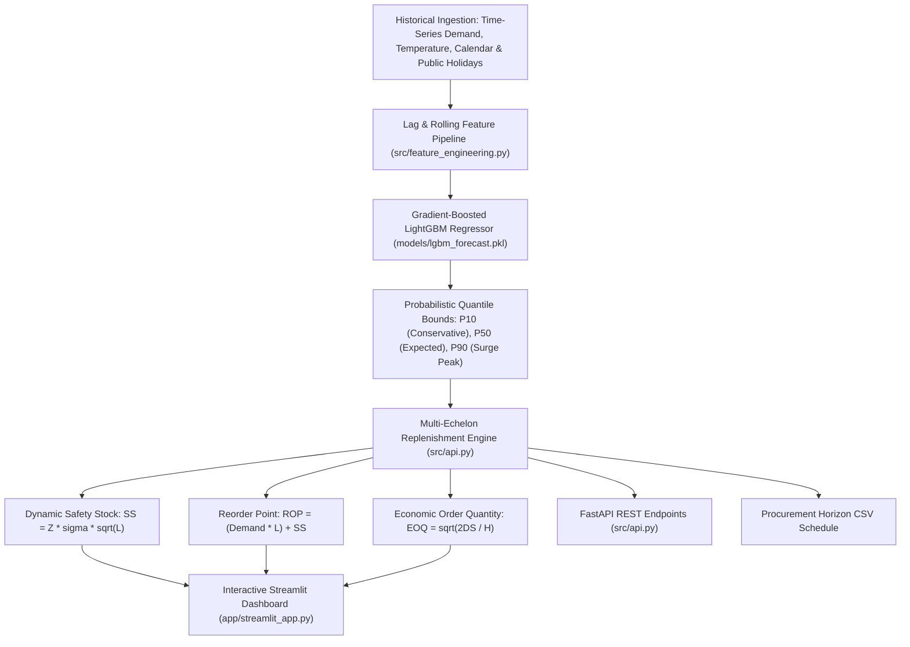

# Supply Chain Demand Forecasting & Inventory Replenishment Platform

[](https://demand-forecasting-timeseries-2c28agejbap9ell2fr9owv.streamlit.app/)


An enterprise time-series demand intelligence platform delivering probabilistic quantile forecasting (P10, P50, P90) coupled with dynamic Safety Stock and Economic Order Quantity (EOQ) replenishment optimization for supply chain operations.

---

## Architecture Flow



---

## Commercial Use Case

Inventory mismanagement directly erodes profitability:
1. **Stockouts**: Unanticipated demand surges cause lost orders and customer churn.
2. **Overstocking**: Excess safety inventory bloats working capital and causes warehouse spoilage.
3. **Vendor Delays**: Fluctuating supplier lead times disrupt order schedules without automated buffer recalculation.

This platform automates the entire replenishment lifecycle:
- **Probabilistic Forecasting**: Produces P10 (conservative lower bound), P50 (expected median), and P90 (surge peak) projections instead of brittle single-point estimates.
- **Dynamic Safety Buffers**: Continuously adjusts safety stock according to rolling demand volatility ($\sigma$) and target cycle service levels (90% to 99%).
- **Replenishment Automation**: Calculates exact Reorder Points (ROP) and Economic Order Quantities (EOQ) to minimize carrying costs.

---

## API Endpoints

### 1. Health Check
```http
GET /health
```
Response:
```json
{
  "status": "ok",
  "service": "demand-forecasting-inventory-replenishment",
  "model_loaded": true
}
```

### 2. Probabilistic Demand Forecast
```http
POST /predict
Content-Type: application/json

{
  "hour": 14,
  "temp": 24.5,
  "is_holiday": 0,
  "day_of_week": 1,
  "month": 7,
  "quarter": 3,
  "is_weekend": 0,
  "lag_7": 125.0,
  "lag_14": 118.0,
  "lag_30": 112.0,
  "rolling_mean_7": 122.0,
  "rolling_std_7": 16.0,
  "rolling_mean_30": 115.0
}
```
Response:
```json
{
  "timestamp": "2026-10-22T23:55:00.000Z",
  "predicted_demand": 126.9,
  "quantile_p10": 106.4,
  "quantile_p90": 147.4,
  "volatility_index": 16.0
}
```

### 3. Inventory Replenishment Policy Calculation
```http
POST /api/v1/inventory-policy
Content-Type: application/json

{
  "daily_demand": 126.9,
  "demand_std": 16.0,
  "lead_time_days": 7,
  "service_level": 0.95,
  "order_cost": 50.0,
  "holding_cost_annual": 18.0
}
```

---

## Local Setup & Development

### 1. Environment Installation
```bash
git clone https://github.com/MuhammadMinhaj229/demand-forecasting-timeseries.git
cd demand-forecasting-timeseries
pip install -r requirements.txt
```

### 2. Run Test Suite
```bash
python -m pytest tests/
```

### 3. Launch Streamlit Executive Hub
```bash
streamlit run app/streamlit_app.py
```

### 4. Launch FastAPI Server
```bash
uvicorn src.api:app --host 0.0.0.0 --port 8000 --reload
```
